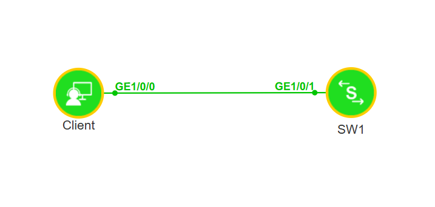

# 01：登录华为交换机

本实验把设备重命名为SW1，配置 VLANIF 管理地址并配置SSH 服务，使用 AAA 认证登录方式，最后用基本 ACL 限制可登录的主机。

<!-- more -->

## 1、实验需求

（1）将设备重命名为SW1；

（2）通过SSH远程登录；

（3）采用本地 aaa 认证，用户名为 administrator，密码为 Skills39.com。

## 2、网络拓扑

拓扑：


实验1：交换机配置SSH组网。

| 设备 | 接口 | IP/掩码 | 所属 VLAN / 角色 |
| --- | --- | --- | --- |
| Client | G0/0/0 | 192.168.1.1/24 | Telnet 客户端 |
| SW1 | G1/0/1（Access） | — | 接入 VLAN 100 |
| SW1 | Vlanif100 | 192.168.1.254/24 | SSH服务端管理地址 |

## 3、配置过程与命令

### Step1：设备重命名，创建 VLAN，并把接入划入 VLAN

```text
<Huawei> system-view //进入系统模式
[Huawei] sysname SW1 //设备重命名为SW1
[SW1] vlan 100 //创建vlan
[SW1-vlan100] quit //退出vlan模式
[SW1] interface G1/0/1 //进入接口g0/0/1
[SW1-GigabitEthernet1/0/1] port link-type access //接口设置为access
[SW1-GigabitEthernet1/0/1] port default vlan 100 //把接口放入VLAN100
[SW1] interface vlanif 100 //进入三层vlanif接口
[SW1-Vlanif100] ip address 192.168.1.254 24 //配置IP地址，掩码/24
[SW1-Vlanif100] quit //退出
```


### Step2：配置设备SSH远程登陆功能

```text
[SW1] ssh server-source all-interface //配置所有接口均可通过SSH登录CLI
Warning: SSH server source configuration will take effect in the next login. Continue? [Y/N]:y
Warning: It expands the range of accessed IP.

[SW1] stelnet ipv4 server enable //开启stelnet server功能

```

### Step3：配置基本VTY（虚拟终端）

```text
[SW1] user-interface vty 0 4 //开启用户登录接口0-4
[SW1-ui-vty0-4] protocol inbound ssh //通过ssh协议登录
[SW1-ui-vty0-4]authentication-mode aaa //设置为aaa登录
```

### Step4：配置AAA

```
[SW1] aaa //启用aaa
[SW1-aaa]local-user administrator password-force-change disable //禁用首次登录强制密码更改
[SW1-aaa] local-user administrator password irreversible-cipher Skills39.com //配置用户名密码
[SW1-aaa] local-user administrator service-type ssh //用户用于ssh
[SW1-aaa] local-user administrator privilege level 3 //用户等级为3
[SW1-aaa] quit //退出来
```

### Step5：PC 上登录验证

```text
PC> ssh administrator@192.168.1.254 //ssh登录设备

The authenticity of host '192.168.1.254 (192.168.1.254)' can't be established.
RSA key fingerprint is SHA256:bV2zJ5uHSaenL1r8UgROsChr15ppORisg6aZsvtkbB0.
No matching host key fingerprint found in DNS.
This key is not known by any other names
Are you sure you want to continue connecting (yes/no/[fingerprint])? yes   //yes
Could not create directory '/home/pc/.ssh' (Permission denied).

Failed to add the host to the list of known hosts (/home/pc/.ssh/known_hosts).


administrator@192.168.1.254's password:  //输入密码，默认是隐藏的
<SW1> //登录成功
```

## 附1：如果有 ACL 限制用户登录

```text
[SW1] acl 2000 //配置ACL
[SW1-acl-basic-2000] rule 10 deny source 192.168.1.254 0.0.0.0 //拒绝主机
[SW1-acl-basic-2000] user-interface vty 0 4 //进入VTY接口
[SW1-ui-vty0-4] acl 2000 inbound //应用ACL，限制ACL匹配的主机192.168.1.254登录
```
