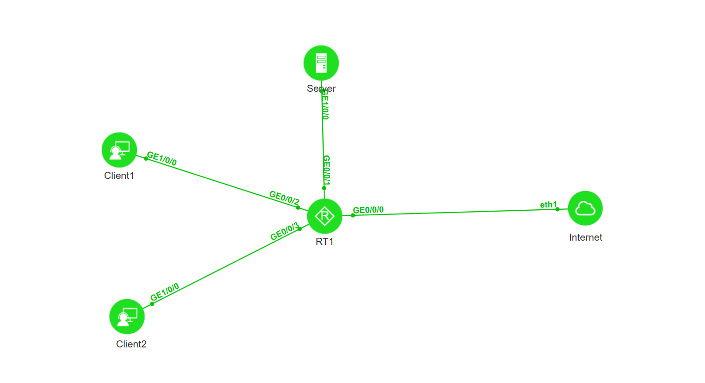

# 02：ACL原理及应用

本实验先梳理 ACL 的匹配机制、分类和配置步骤，再在路由器上用高级 ACL 3000 实现流量过滤：禁止Client2访问服务器，Client1不受限制。

<!-- more -->

## 一、ACL 功能简介

- 访问控制列表 ACL 是由一系列规则组成的集合，ACL 通过这些规则对数据包进行分类，从而设备可以对不同类报文进行不同的处理。
- ACL 的规则匹配：报文到达设备时，查找引擎从报文中取出信息组成查找键值，键值与 ACL 中的规则进行匹配，只要有一条规则和报文匹配，就停止查找，称为命中规则。查找完所有规则，如果没有符合条件的规则，称为未命中规则，故 ACL 的规则分为“permit”（允许）规则或者“deny”（拒绝）规则和未命中规则。
- 常用 ACL 的功能分类如下表所示：

| 分类 | 编号范围 | 应用场景 |
| --- | --- | --- |
| 基本 ACL | 2000-2999 | 使用报文的源 IP 地址和时间段信息来定义规则 |
| 高级 ACL | 3000-3999 | 除了基本 ACL 的应用场景外，还支持基于目的地址、IP 优先级、报文类型、源目端口号来定义规则 |

## 二、ACL 配置命令与步骤

1. （可选）配置 ACL 生效的时间段，执行命令 `time-range` 配置 acl 生效的时间段；
2. 配置 ACL 编号，执行命令 `acl number` 配置一条 acl（number 不同，acl 可以匹配的参数也不同，具体的 acl 编号请参考上表）；
3. 配置 ACL 规则，执行命令 `rule permit|deny` 配置 ACL 的具体规则；
4. 应用 ACL，ACL 可以在很多特性中被应用，例如：流策略里面对 ACL 匹配的数据流执行相应的动作、登陆设备的时候调用 ACL 对登陆设备的用户做限制等。

## 三、组网需求与网络拓扑

拓扑：


如图所示，公司为保证数据安全，禁止Client2访问财务服务器，但Client1不受限制。

| 设备 / 区域 | 连接的路由器接口 | 网段 / IP | 说明 |
| --- | --- | --- | --- |
| Internet | G0/0/0 |  | 禁止访问财务服务器 |
| Server | G0/0/1 | 192.168.3.100/24 | 允许访问财务服务器 |
| Client2 | G0/0/2 | 192.168.2.0/24 | 被保护对象，ACL 应用在此接口出方向 |
| Client1 | G0/0/3 | 192.168.1.0/24 | 来自 Internet 的访问也被禁止 |

## 四、路由器 ACL 核心配置

```text
[Huawei] acl 3000 //启动ACL3000，高级ACL
[Huawei-acl-adv-3000] rule 10 deny ip source 192.168.1.0 0.0.0.255 destination 192.168.3.100 0.0.0.0 //拒绝研发部访问财务部服务器，0.0.0.0表示只匹配192.168.3.100这一台服务器，而0.0.0.255匹配的是192.168.1.0/24网段的主机
[Huawei-acl-adv-3000] rule 20 permit ip source 192.168.2.0 0.0.0.255 destination 192.168.3.100 0
[Huawei-acl-adv-3000] rule 30 deny ip source any destination 192.168.3.100 0.0.0.0 //拒绝其他所有源访问财务服务器，0.0.0.0可以简写成0

[Huawei] int g0/0/2
[Huawei-GigabitEthernet0/0/2] traffic-filter outbound acl 3000
```

> **提示**：首先需要保障设备互联互通，不要忘记配置默认网关。
